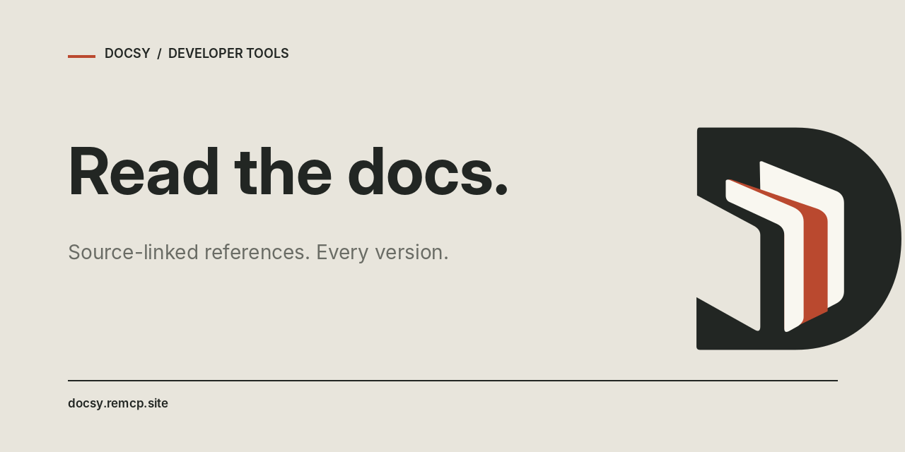

<p align="center">
  
</p>

<h1 align="center">Docsy</h1>

<p align="center">
  <strong>Developer docs your AI can verify.</strong><br>
  Version-aware answers · Official source links · Five read-only MCP tools
</p>

<p align="center">
  <a href="https://chatgpt.com/plugins/plugin_asdk_app_6ad6814ca7708191956117b3a3b58eb5"></a>
</p>

<p align="center">
  <a href="https://docsy.remcp.site"><strong>Website</strong></a>
  &nbsp;·&nbsp; <a href="https://docsy.remcp.site/docs">Documentation</a>
  &nbsp;·&nbsp; <a href="#quick-start">Quick start</a>
  &nbsp;·&nbsp; <a href="#where-docsy-is-published">Where to find Docsy</a>
  &nbsp;·&nbsp; <a href="docs/README.zh-CN.md">简体中文</a>
</p>

<p align="center">
  <a href="https://github.com/getremcp/docsy-plugin/actions/workflows/plugin-quality.yml"></a>
  <a href="https://github.com/getremcp/docsy-plugin/releases/latest"></a>
  <a href="https://github.com/getremcp/docsy-plugin/stargazers"></a>
  <a href="https://github.com/getremcp/docsy-plugin/commits/main"></a>
  <a href="LICENSE"></a>
</p>

<p align="center">
  <a href="https://www.npmjs.com/package/@remcp/docsy-sdk"></a>
  <a href="https://www.npmjs.com/package/@remcp/docsy-cli"></a>
  <a href="https://www.npmjs.com/package/@remcp/docsy-sdk"></a>
  <a href="https://www.npmjs.com/package/@remcp/docsy-cli"></a>
</p>

<p align="center">
  <a href="https://registry.modelcontextprotocol.io/v0.1/servers/io.github.getremcp%2Fdocsy/versions/latest"></a>
  <a href="https://glama.ai/mcp/connectors/io.github.getremcp/docsy"></a>
  <a href="https://github.com/getremcp/docsy-plugin/releases"></a>
</p>

<p align="center">
  <a href="https://chatgpt.com/plugins/plugin_asdk_app_6ad6814ca7708191956117b3a3b58eb5"><strong>Open in ChatGPT</strong></a>
  &nbsp;·&nbsp; <a href="#quick-start"><strong>Connect Claude / Cursor / Codex</strong></a>
  &nbsp;·&nbsp; <a href="docs/ACCOUNT-FREE-REVIEW.md"><strong>Try without a Docsy account</strong></a>
</p>

<p align="center">
  
</p>

> **Live metrics, not vanity numbers.** npm version and monthly-download badges use public npm data; GitHub checks, stars and asset-download badges update independently. For reference, the npm downloads API reported **717 SDK** and **846 CLI** package downloads for 30 September–29 October 2026 (1,563 package downloads combined, not unique users). The badge values will change over time. GitHub release-asset downloads are **not** npm downloads.

---

## Why Docsy?

Coding assistants can mix documentation from different versions or give answers without a checkable source. Docsy helps them resolve the right library, find version-specific documentation and return links to the original publisher files or pages.

- **Version-aware:** ask for a specific release and see which versions are indexed; upstream tags alone do not imply indexed documentation.
- **Source-linked:** excerpts include origin URLs and, when available, a pinned Git revision.
- **Focused:** retrieve the relevant passage or request links without loading an entire manual.
- **Read-only:** no local shell execution, file writes or access to your private repositories.

### MCP tools

| Tool | Use it for |
| --- | --- |
| `resolve-library-id` | Match a framework, package or SDK name to its documentation ID |
| `list-library-versions` | Discover available versions and indexed status |
| `query-docs` | Get focused excerpts or source links for a chosen library/version |
| `search` | Search the public documentation index |
| `fetch` | Read a returned result by ID or a verified publisher page |

For example, ask: **“Using official React documentation, explain `useEffect` cleanup and cite the original source.”**

## Quick start

Pick the connection that suits your workflow. The hosted MCP service runs remotely, so you do **not** need to clone this repository or install a local server.

| Client | Fastest path |
| --- | --- |
| **ChatGPT** | [Open the publisher-provided Docsy plugin link](https://chatgpt.com/plugins/plugin_asdk_app_6ad6814ca7708191956117b3a3b58eb5) (availability depends on your account) |
| **Claude Code** | `claude mcp add --transport http docsy https://docsy.remcp.site/mcp/registry` |
| **Codex CLI** | `codex mcp add docsy --url https://docsy.remcp.site/mcp/registry`, then `codex mcp login docsy` |
| **Cursor / VS Code** | Add a Streamable HTTP MCP server pointing to `https://docsy.remcp.site/mcp/registry` |
| **Any MCP-compatible client** | Use the OAuth 2.1 endpoint `/mcp/registry`; for an anonymous, rate-limited public-corpus evaluation, use `/mcp/public` |

**Example prompt:** *“Find the official React documentation for cleaning up a `useEffect`. Use the relevant version and cite its source.”*

See [Client integrations](docs/CLIENT-INTEGRATIONS.md), [Getting started](docs/GETTING-STARTED.md), or [Account-free evaluation](docs/ACCOUNT-FREE-REVIEW.md) for complete setup instructions.

## Use Docsy in ChatGPT

**[Open the Docsy ChatGPT plugin](https://chatgpt.com/plugins/plugin_asdk_app_6ad6814ca7708191956117b3a3b58eb5).**

This is the publisher-provided ChatGPT plugin link. Availability and sign-in depend on your ChatGPT account and client. A direct URL is not evidence of an independently verified public marketplace approval.

## Connect your AI client

Two **separate** hosted MCP endpoints serve different use cases:

| Endpoint | Access | Purpose |
| --- | --- | --- |
| `https://docsy.remcp.site/mcp/registry` | OAuth 2.1 | Canonical account-linked MCP connection |
| `https://docsy.remcp.site/mcp/public` | No Docsy account or API key | Rate-limited evaluation against **public** documentation |

Both expose the five read-only tools. The public endpoint does **not** make private libraries, account data or arbitrary web URLs accessible. On 31 October 2026, anonymous `initialize`, `tools/list`, `resolve-library-id` and `query-docs` passed a live MCP protocol smoke test; the canonical endpoint still returned HTTP 401 without OAuth. This is **not** a claim of a completed Codex CLI agent test.

**Claude Code — canonical OAuth endpoint**

```sh
claude mcp add --transport http docsy https://docsy.remcp.site/mcp/registry
```

**Codex CLI — canonical OAuth endpoint**

```sh
codex mcp add docsy --url https://docsy.remcp.site/mcp/registry
codex mcp login docsy
```

**Cursor, VS Code and other remote MCP clients** — configure a Streamable HTTP connection to the canonical URL:

```json
{
  "mcpServers": {
    "docsy": {
      "type": "http",
      "url": "https://docsy.remcp.site/mcp/registry"
    }
  }
}
```

For account-free evaluation and protocol-level commands, see [Public MCP evaluation](docs/ACCOUNT-FREE-REVIEW.md). Some clients initiate OAuth discovery on their own even for an anonymous endpoint; client-specific behavior must be verified separately.

More guides: [Getting started](docs/GETTING-STARTED.md) · [Client integrations](docs/CLIENT-INTEGRATIONS.md) · [Claude Code community plugin manifest](.claude-plugin/marketplace.json).

## Where Docsy is published

Docsy is available through **official registry records, npm, GitHub, independent directories, and client configuration**. Being listed in a community directory does **not** mean approved by the official ChatGPT, Anthropic, Cursor, or Codex marketplace.

### Official registry & packages

| Platform | Listing | Verified state |
| --- | --- | --- |
| **MCP Registry** | [`io.github.getremcp/docsy`](https://registry.modelcontextprotocol.io/v0.1/servers/io.github.getremcp%2Fdocsy/versions/latest) | Published **v1.0.9**, OAuth 2.1 |
| **npm** | [`@remcp/docsy-sdk`](https://www.npmjs.com/package/@remcp/docsy-sdk) · [`@remcp/docsy-cli`](https://www.npmjs.com/package/@remcp/docsy-cli) | Published **v0.1.2** / **v0.1.4**; monthly downloads shown above |
| **GitHub Releases** | [Stable release & downloadable assets](https://github.com/getremcp/docsy-plugin/releases/latest) | Stable **plugin-v1.0.9**; v1.0.10 is a prerelease review candidate |
| **ChatGPT** | [Publisher-provided direct plugin link](https://chatgpt.com/plugins/plugin_asdk_app_6ad6814ca7708191956117b3a3b58eb5) | Direct link exists; independent public marketplace approval **not verified** |
| **Claude Code** | [Community marketplace manifest](.claude-plugin/marketplace.json) | Installable from GitHub; **not** an official Anthropic listing |
| **Gemini CLI** | [GitHub extension release](https://github.com/getremcp/docsy/releases/tag/gemini-v1.0.0) | GitHub-distributed extension; gallery approval not claimed |

### Public directories

| Directory | Public record |
| --- | --- |
| [Glama](https://glama.ai/mcp/connectors/io.github.getremcp/docsy) | Public connector page, five tools |
| [LobeHub MCP Marketplace](https://lobehub.com/mcp/getremcp-docsy-plugin) | Public Docsy v1.0.9 listing, linked to the canonical OAuth endpoint |
| [Cursor Directory](https://cursor.directory/plugins/docsy) | Previously verified listing (live automated recheck was rate-limited on 31 October) |
| [Launch MCP](https://launchmcp.co/mcp/servers/getremcp/docsy-plugin) | Public listing |
| [MCPRepository](https://mcprepository.com/getremcp/docsy-plugin) | Public listing |
| [Ext Ops Panel](https://extops.dev/plugins/mcp/io.github.getremcp/docsy) | Public indexed Docsy profile |
| [LibHunt](https://www.libhunt.com/r/getremcp/docsy) | Public SDK & CLI project index |
| [Walnut World](https://walnut.world/w/docsy-plugin) | Public GitHub-indexed Docsy package; publisher ownership unclaimed |
| [AI Anytime Awesome MCP Servers](https://github.com/AIAnytime/Awesome-MCP-Servers/pull/313) | Directory PR merged |
| [TensorBlock MCP Index](https://github.com/TensorBlock/awesome-mcp-servers/pull/4485) | Directory PR merged |
| [Sagargupta Awesome MCP Servers](https://github.com/Sagargupta16/awesome-mcp-servers/pull/212) | Directory PR merged |
| [ToolSDK MCP Registry](https://github.com/toolsdk-ai/toolsdk-mcp-registry/pull/1016) · [mcpHQ](https://github.com/mcpHQ/awesome-mcp-servers/pull/452) · [Collabnix](https://github.com/collabnix/awesome-mcp-lists/pull/279) | Directory PRs merged |
| [VoltAgent](https://github.com/VoltAgent/official-mcp-servers/pull/55) · [PenguinMiaou](https://github.com/PenguinMiaou/awesome-claude-code-plugins/pull/12) · [Awesome AI Coding Tools](https://github.com/mahmoudsajjadi/awesome-ai-coding-tools/pull/10) | Directory PRs merged |

**More listings and review status:** [Live site overview](https://docsy.remcp.site/distribution) · [Full publication & submission tracker](docs/DISTRIBUTION-STATUS.md) includes LobeHub, regional directories, pending PRs, rejected submissions and historical identities. Pending submissions are not presented as published. **Smithery's hosted proxy/API shut down on 31 October 2026;** use the direct MCP endpoint instead.

## Releases, scope and security

This repository is the **public integration and distribution package**, not the hosted Docsy backend. It intentionally includes plugin manifests, client settings, read-only skill metadata, reviewed documentation and brand assets; it does **not** include crawlers, database contents, deployment secrets or a local server implementation.

- Use the [stable GitHub release](https://github.com/getremcp/docsy-plugin/releases/latest) for downloadable plugin assets; don't assume prereleases are approved marketplace versions.
- The canonical endpoint uses OAuth 2.1; the public evaluator has its own rate limits and public-corpus boundaries.
- Never include credentials, personal information or proprietary code in documentation queries or public security reports.
- For a vulnerability or potential exposure, follow [SECURITY.md](SECURITY.md), not a public issue containing sensitive details.

[SDK & CLI repository](https://github.com/getremcp/docsy) · [Distribution tracker](docs/DISTRIBUTION-STATUS.md) · [Privacy](https://docsy.remcp.site/privacy) · [Terms](https://docsy.remcp.site/terms) · [Support](https://docsy.remcp.site/support) · [MIT License](LICENSE)

<p align="center"><sub>Docsy is an independent documentation service. External directory listings do not imply endorsement by their platform owners.</sub></p>
